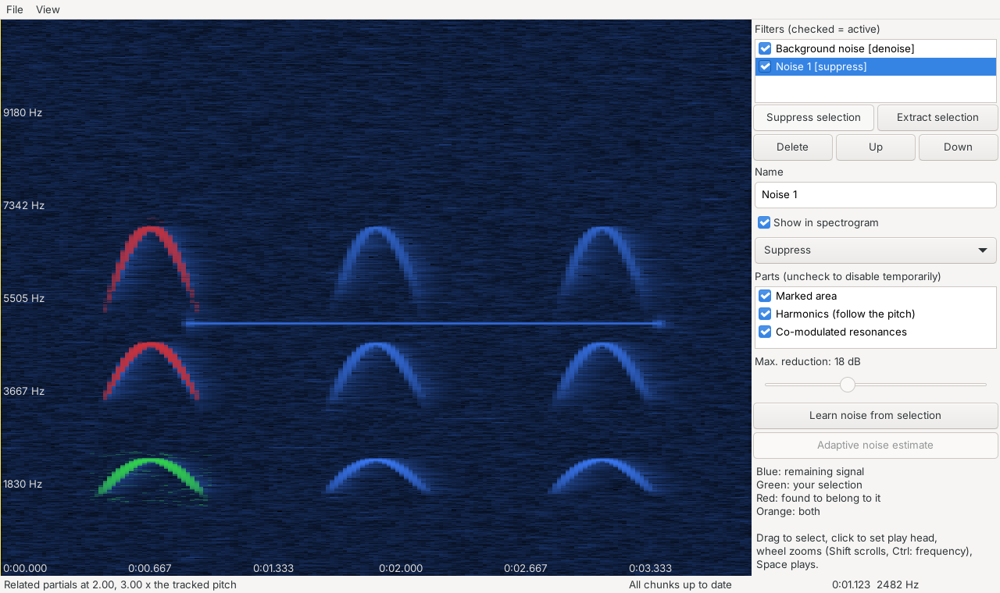

# noiseextractor

Interactively mark noises in the spectrogram of an audio file, then suppress or
extract them, together with everything the program finds to belong to them.



## What it does

* **Spectrogram with a colour code**: blue is the signal that remains after all
  active filters, green is the area you marked, red is what the analysis
  believes belongs to the marked sound, orange is both.
* **Mark a part of a sound, find the rest.** Drag a rectangle around, say, the
  fundamental of a bird call. The analysis tracks the pitch inside the
  rectangle frame by frame and looks for partials that follow it at rational
  ratios (overtones, and sub-harmonics if you marked an overtone), so a
  drifting pitch is no problem. Resonances that do not move with the pitch
  but swell and fade together with it are found by common modulation.
* **Background noise removal that keeps the sound intact.** Instead of a gate
  that deletes everything below the noise floor (which eats attack and decay
  and changes the balance of partials), the noise filter uses a soft spectral
  gain with decision-directed SNR smoothing (Wiener or MMSE log-spectral
  amplitude). Loud sounds pass almost unchanged, and the gain never drops
  below a configurable floor. The noise spectrum is estimated adaptively or
  learned from a noise-only stretch you select.
* **A filter building kit.** Filters are listed on the right; each can be
  named, switched on and off, shown or hidden in the spectrogram, set to
  *suppress* or *extract*, and its parts (marked area, harmonics,
  co-modulated resonances) can be disabled temporarily.
* **Responsive with long recordings.** Processing runs on background threads
  in chunks of a few seconds, nearest to the play head, the selection and the
  visible area first. A one-hour recording is usable immediately; the rest is
  processed while you work.

## Building

You need a stable Rust toolchain, CMake and a C++ compiler. The GUI uses
[wxDragon](https://github.com/AllenDang/wxDragon), which downloads and compiles
wxWidgets on the first build (that takes a few minutes).

* **Linux** (Debian/Ubuntu):
  `sudo apt-get install libgtk-3-dev libasound2-dev libpng-dev libjpeg-dev libtiff-dev libexpat1-dev libclang-dev pkg-config cmake`
* **macOS**: Xcode command line tools and CMake.
* **Windows**: Visual Studio (C++ build tools) and CMake.

```sh
cargo run --release -p noiseextractor -- recording.flac    # the GUI
cargo run --release -p noiseextractor-cli -- --help        # the command-line tool
cargo test --workspace                                     # all tests
```

`cargo build`/`cargo test` at the workspace root without `--workspace` only
build the headless crates (core and CLI), which is quick and needs no GUI
libraries.

## Using the GUI

| Action | How |
| --- | --- |
| Open a recording | File > Open audio (Ctrl+O), or pass it on the command line |
| Mark a sound | Drag a rectangle in the spectrogram |
| Turn it into a filter | *Suppress selection* or *Extract selection* |
| Set the play head | Click |
| Play / pause | Space (plays the selection if there is one), or Ctrl+P |
| Zoom time / scroll / zoom frequency | Wheel / Shift+wheel / Ctrl+wheel |
| Learn the background noise | Mark a noise-only stretch, *Learn noise from selection* |
| Save the filter list | File > Save project (Ctrl+S) |
| Write the result | File > Export processed audio (Ctrl+E) |

## Command-line tool

`noiseextractor-cli` runs the same processing without a window, e.g. for
batch jobs or tests:

```sh
noiseextractor-cli denoise in.flac -o clean.wav --noise-from 0.0:1.5 --save-project p.json
noiseextractor-cli mark in.flac --time 12.3:13.1 --freq 2000:4500 --name blackbird \
    --extract --project p.json --save-project p.json
noiseextractor-cli process in.flac --project p.json -o out.wav
noiseextractor-cli spectrogram in.flac --project p.json -o view.png --max-hz 10000
```

`mark` prints which harmonic ratios it found, so you can check what a filter
will grab before applying it.

## How filters combine

Every filter describes its target as a soft mask m between 0 and 1 per
time-frequency bin. *Suppress* multiplies the signal by √(1 − m²) (removes the
target's share of the energy), *extract* keeps m. All active extract filters
are combined as a union, then every suppress filter is applied. Suppressing and
extracting the same target therefore add up (in power) to the original.

## Project layout

| Crate | Purpose |
| --- | --- |
| `crates/core` (`noiseextractor-core`) | STFT, noise reduction, selection analysis, filter model, background engine, renderer. No GUI dependencies. |
| `crates/cli` (`noiseextractor-cli`) | Command-line front end and end-to-end tests. |
| `crates/gui` (`noiseextractor`) | wxDragon GUI and audio playback (cpal). |

## Planned

* Learn a spectral template (NMF) from a marked sound and find its other
  occurrences in the whole recording.
* Smoother adaptive noise estimate across chunk borders.
* Undo/redo and editing a filter's rectangle after creating it.

## License

GPL-3.0-or-later, see [LICENSE](LICENSE).
